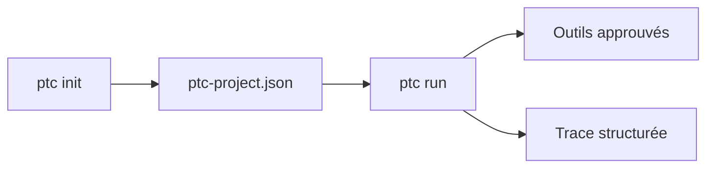

# andreasronge/ptc_runner

> Langage et runtime pour agents : boucles bornées qui vérifient leur travail, pour développeurs d'agents.

## Le problème
Les agents lancés sans bornes ni traces sont difficiles à vérifier et à corriger quand ils échouent.

## Ce que ça fait vraiment
PtcRunner propose un langage petit et typé, limité aux outils approuvés et découverts dans un REPL, et un runtime pour services d'agents : tâches bornées, traçables, nombreuses requêtes concurrentes, sans bureau ni conteneur par agent. La commande `ptc` crée et exécute des projets, sans clé d'API pour l'exemple, et laisse une trace structurée.

## Comment c'est branché
Schéma simplifié d'après la fiche, sans diagramme fourni.



## Essayer
```console
ptc init hello-ptc
ptc run hello-ptc/ptc-project.json
```

## Coût et pièges
Archive autonome pour macOS arm64, image de conteneur pour Linux AMD64 et ARM64. Projet en version 0.x : le README annonce des changements incompatibles. Les coûts d'un vrai modèle ne sont pas précisés.

## Ce que ce n'est pas
Ce n'est pas un framework stable : le README parle de développement actif. L'exemple ne montre pas d'appel à un modèle de langage.

## Alternatives
Aucune alternative nommée dans le README.

## Pour toi
À surveiller : approche intéressante pour des agents bornés et traçables, mais en 0.x avec un seul mainteneur ; à retester avant tout usage sérieux.

