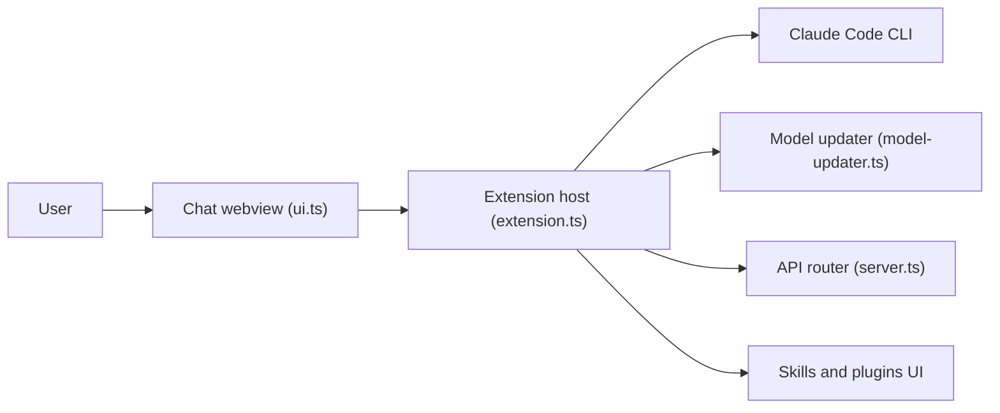

# andrepimenta/claude-code-chat

> VS Code extension that replaces the Claude Code terminal with a chat interface, for developers.

## The problem
Using Claude Code on the command line is less comfortable than in the editor, with no visual history or state restoration.

## What it actually does
The extension launches the Claude Code CLI and relays its events into a webview: streaming, built-in diffs, Git checkpoints to restore state, conversation history, permission management ("YOLO" mode possible), pasted images, Plan and thinking modes. It also offers a marketplace of MCP servers, skills and plugins, and an OpenAI-compatible router for other models.

## How it is wired


## Trying it
```bash
ext install claude-code-chat
```
Then `Ctrl+Shift+C` (or `Cmd+Shift+C`) to open the chat.

## Cost and gotchas
Requires the Claude Code CLI, Node 18+ and a Claude API or subscription (cost on you). YOLO mode removes permission checks. 178 open issues.

## What it is not
Not an official Anthropic client; the author says they built it with Claude Code. License present but not identified by GitHub.

## Alternatives
No alternative named in the README.

## For you
Worth watching: handy if you work in VS Code or Cursor with Claude Code, but the unclear license and 178 open issues call for testing before depending on it.
