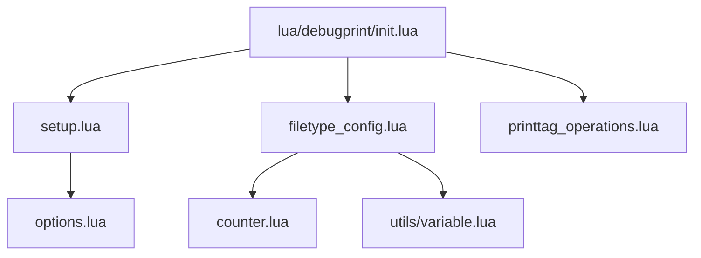

# andrewferrier/debugprint.nvim

> Neovim plugin that inserts debug print lines adapted to the language being edited.

## The problem
Writing debug prints by hand, then finding and removing them, is tedious.

## What it actually does
Inserts print lines with file, line number, a persistent counter and a variable detected by treesitter (40 file types). Lets you delete, comment out, browse and search these lines via fzf-lua, telescope or snacks.

## How it is wired


## Trying it
```bash
# Dans Neovim 0.11 ou plus, après installation par lazy.nvim :
# g?p (print simple dessous), g?v (variable), ]g (suivant)
:Debugprint delete
:Debugprint search
```

## Cost and gotchas
Neovim 0.11 or later. A formatter that splits a line breaks automatic deletion. The README is truncated in the comparison table.

## What it is not
Not a debugger: it generates prints. It does not replace nvim-dap.

## Alternatives
- timber.nvim, nvim-chainsaw, printer.nvim, refactoring.nvim (compared in the README).

## For you
Worth watching: handy if you debug Python with prints under Neovim; useless elsewhere.
