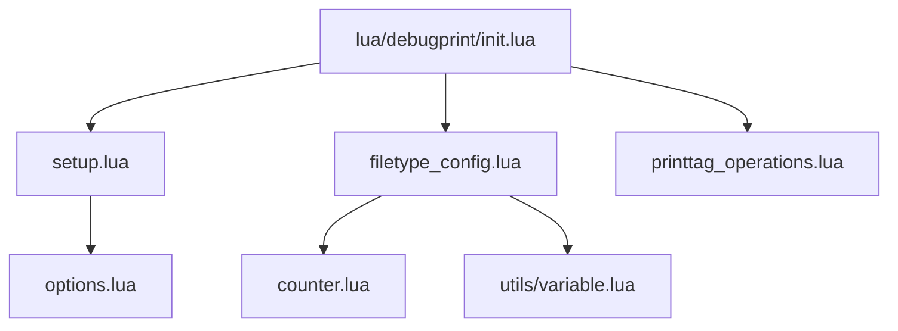

# andrewferrier/debugprint.nvim

> Plugin Neovim qui insère des lignes d'impression de débogage adaptées au langage édité.

## Le problème
Écrire à la main des print de débogage, puis les retrouver et les supprimer, est fastidieux.

## Ce que ça fait vraiment
Insère des lignes print avec fichier, numéro de ligne, compteur persistant et variable détectée par treesitter (40 types de fichiers). Permet de supprimer, commenter, parcourir et chercher ces lignes via fzf-lua, telescope ou snacks.

## Comment c'est branché


## Essayer
```bash
# Dans Neovim 0.11 ou plus, après installation par lazy.nvim :
# g?p (print simple dessous), g?v (variable), ]g (suivant)
:Debugprint delete
:Debugprint search
```

## Coût et pièges
Neovim 0.11 ou plus. Le formateur qui coupe une ligne casse la suppression automatique. Le README est tronqué dans le tableau de comparaison.

## Ce que ce n'est pas
Pas un débogueur : il génère des print. Il ne remplace pas nvim-dap.

## Alternatives
- timber.nvim, nvim-chainsaw, printer.nvim, refactoring.nvim (comparés dans le README).

## Pour toi
À surveiller : pratique si tu déboggues Python au print sous Neovim ; inutile ailleurs.

