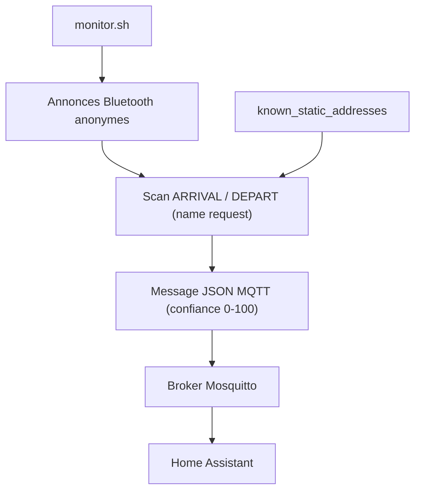

# andrewjfreyer/monitor

> A Bluetooth presence-detection bash script that publishes over MQTT for home automation, on a Raspberry Pi.

## The problem
Knowing whether a phone or a beacon is at home without a dedicated app. Constantly polling every device disrupts Wi-Fi on 2.4 GHz.

## What it actually does
The script listens for anonymous Bluetooth advertisements, then triggers arrival or departure `name` requests to the addresses listed in `known_static_addresses`. It publishes a JSON message with a confidence level from 0 to 100 to an MQTT broker. It also tracks beacons (iBeacon) and can run on several cooperating nodes. The README gives an example integration with Home Assistant.

## How it is wired
Simplified diagram based on the fiche, no diagram provided.



## Trying it
```bash
git clone https://github.com/andrewjfreyer/monitor.git
cd monitor/
sudo bash monitor.sh
```

## Cost and gotchas
Free, but you need a Raspberry Pi (the README describes a Pi Zero W), Mosquitto 1.5 or later and an MQTT broker. Requests that are too frequent can disrupt Wi-Fi. Last push in July 2024; no license declared.

## What it is not
Not a turnkey service: it is tuned through preference and filter files. It does not detect beacons that respond with randomized addresses without extra configuration.

## Alternatives
No alternative named in the README, apart from an add-on module by @limych and an AppDaemon app by @Odianosen25, which complement it rather than replace it.

## For you
Ignore for your line of work: it is Bluetooth home automation, with no declared license and no recent updates.
