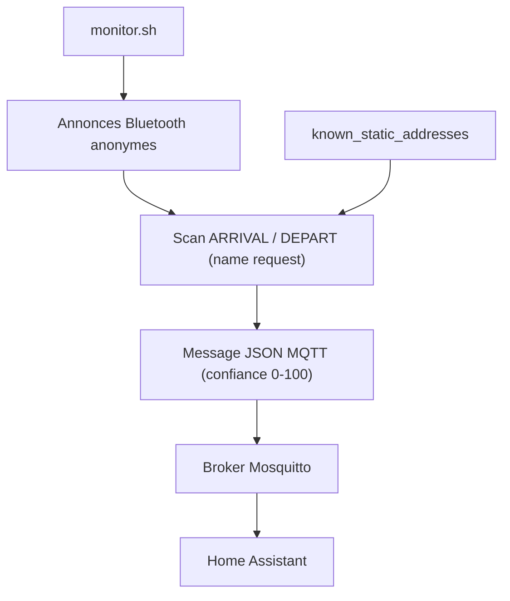

# andrewjfreyer/monitor

> Script bash de détection de présence Bluetooth, qui publie en MQTT pour la domotique, sur Raspberry Pi.

## Le problème
Savoir si un téléphone ou une balise est à la maison sans application dédiée. Interroger sans cesse tous les appareils brouille le Wi-Fi sur 2,4 GHz.

## Ce que ça fait vraiment
Le script écoute les annonces Bluetooth anonymes, puis déclenche des requêtes `name` d'arrivée ou de départ vers les adresses listées dans `known_static_addresses`. Il publie un message JSON avec un niveau de confiance de 0 à 100 sur un broker MQTT. Il suit aussi des balises (iBeacon) et peut tourner sur plusieurs nœuds coopérants. Le README donne un exemple d'intégration avec Home Assistant.

## Comment c'est branché
Schéma simplifié d'après la fiche, sans diagramme fourni.



## Essayer
```bash
git clone https://github.com/andrewjfreyer/monitor.git
cd monitor/
sudo bash monitor.sh
```

## Coût et pièges
Gratuit, mais il faut un Raspberry Pi (le README décrit un Pi Zero W), Mosquitto 1.5 ou plus et un broker MQTT. Des requêtes trop fréquentes peuvent perturber le Wi-Fi. Dernier push en juillet 2024 ; aucune licence déclarée.

## Ce que ce n'est pas
Ce n'est pas un service clé en main : il se règle par fichiers de préférences et filtres. Il ne détecte pas les balises qui répondent à des adresses aléatoires sans réglage supplémentaire.

## Alternatives
Aucune alternative nommée dans le README, hors un module complémentaire de @limych et une application AppDaemon de @Odianosen25, qui s'ajoutent plutôt qu'ils ne le remplacent.

## Pour toi
À ignorer pour ton métier : c'est de la domotique Bluetooth, sans licence déclarée ni mise à jour récente.

