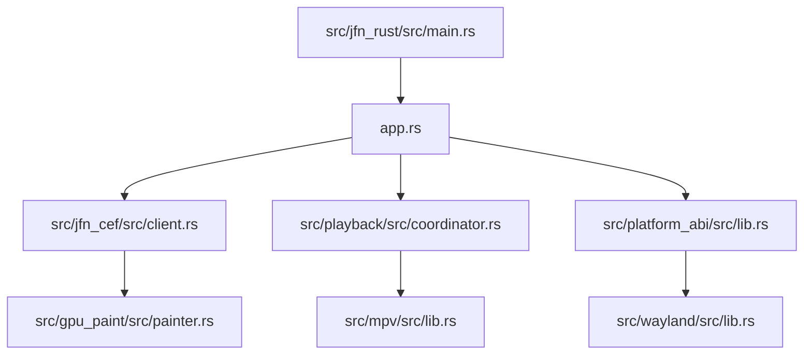

# andrewrabert/jellium-desktop

> Unofficial Jellyfin desktop client, in Rust, built on CEF and mpv.

## The problem
Play your Jellyfin media library on a computer with a real video player rather than a browser.

## What it actually does
The `jfn_rust` binary orchestrates a CEF browser that displays the Jellyfin interface, and an mpv player driven by the playback module. A `platform_abi` layer isolates Wayland, X11 and the others, and `gpu_paint` composites the frames.

## How it is wired


## Trying it
```bash
sudo xattr -cr /Applications/Jellium\ Desktop.app
just build
just run
just test
```

## Cost and gotchas
Free. The Rust compiler and `just` are required to build. On macOS you must remove the quarantine flag. Recent project (January 2026) and unofficial.

## What it is not
Not the official Jellyfin client and not a media server.

## Alternatives
No alternative named in the README.

## For you
Ignore: desktop media player, unrelated to data, AI or MLOps.
