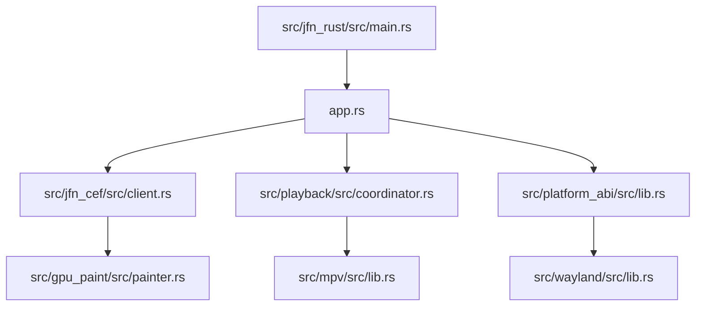

# andrewrabert/jellium-desktop

> Client de bureau Jellyfin non officiel, en Rust, bâti sur CEF et mpv.

## Le problème
Lire sa médiathèque Jellyfin sur ordinateur avec un vrai lecteur vidéo plutôt qu'un navigateur.

## Ce que ça fait vraiment
Le binaire `jfn_rust` orchestre un navigateur CEF qui affiche l'interface Jellyfin, et un lecteur mpv piloté par le module playback. Une couche `platform_abi` isole Wayland, X11 et les autres, et `gpu_paint` compose les images.

## Comment c'est branché


## Essayer
```bash
sudo xattr -cr /Applications/Jellium\ Desktop.app
just build
just run
just test
```

## Coût et pièges
Gratuit. Le compilateur Rust et `just` sont nécessaires pour compiler. Sous macOS il faut retirer la quarantaine. Projet récent (janvier 2026) et non officiel.

## Ce que ce n'est pas
Pas le client officiel de Jellyfin et pas un serveur de médias.

## Alternatives
Aucune alternative nommée dans le README.

## Pour toi
À ignorer : lecteur multimédia de bureau, sans lien avec la data, l'IA ou le MLOps.

