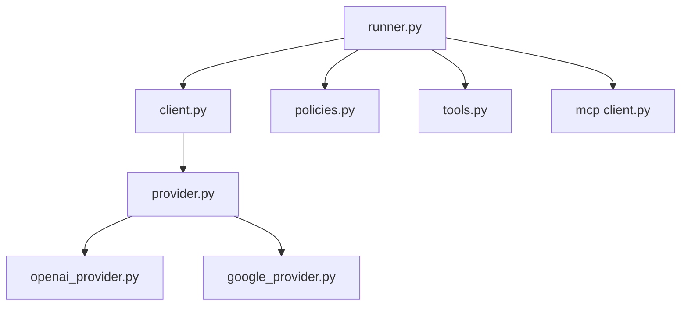

# andrewyng/aisuite

> A single OpenAI-style Python API to call several LLMs and build agents with tools.

## The problem
Each provider has its own SDK, parameters and tool-call format. Switching from one to another forces you to rewrite code.

## What it actually does
`client.chat.completions.create(model="openai:gpt-4o")`: you change provider by changing a string. It handles streaming and async.
Python functions become tools, and `max_turns` runs the call loop.
The Agents API adds `Runner`, toolkits (files, git, shell), approval policies, state persistence (Postgres) and tracing.
It accepts MCP servers. A JS SDK is separate.

## How it is wired


## Trying it
```bash
pip install aisuite
pip install 'aisuite[anthropic]'
pip install 'aisuite[all]'
```

## Cost and gotchas
Provider keys are at your expense. The shell and file toolkits must be constrained by policies.

## What it is not
It is not the OpenWorker app, which now lives in another repository. It is not a proxy gateway: everything happens in-process.

## Alternatives
The README names no alternative repository.

## For you
Adopt: a light, readable abstraction layer, useful for comparing models or writing simple agents without locking yourself into one provider.
