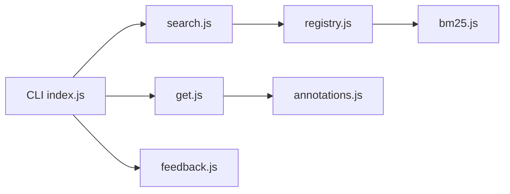

# andrewyng/context-hub

> CLI and MCP server that serve versioned API docs to coding agents.

## The problem
Coding agents invent APIs and forget at the end of a session what they have learned.

## What it actually does
`chub search` queries a registry (BM25 ranking), `chub get <id> --lang py|js` fetches the doc (reference files on demand). The agent can add persistent local annotations (`chub annotate`, replayed with `--with-annotations`, treated as untrusted) and vote on the doc (`chub feedback`), sent to the authors. Content is Markdown in the repository.

## How it is wired


## Trying it
```bash
npm install -g @aisuite/chub
chub search openai
chub get openai/chat --lang py
chub annotate stripe/api "Needs raw body for webhook verification"
```

## Cost and gotchas
Free. Feedback and usage statistics are sent to a feedback service and PostHog (anonymous). Annotations re-injected into the context are a prompt-injection surface. Last push in May 2026.

## What it is not
Not made to be used by hand: designed for the agent. Doc coverage is limited to what is contributed; other content types to come.

## Alternatives
No alternative named in the README.

## For you
Relevant for reducing hallucinated APIs in your coding agent; test it on a few libraries and check what the telemetry sends.
