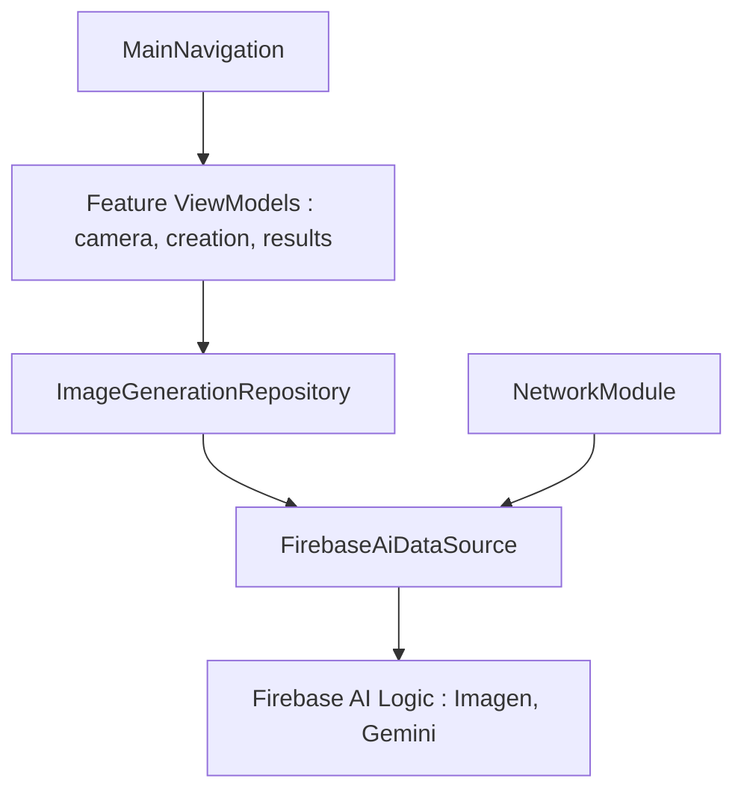

# android/androidify

> Sample Android app that generates a mascot with Gemini, for learning Compose, CameraX and Firebase AI.

## The problem
Show how to build an AI-driven Android app with the latest libraries, without starting from a blank page.

## What it actually does
The user takes a photo, the app calls Imagen and Gemini through the Firebase AI Logic SDK and displays the generated robot. The UI is in Jetpack Compose, navigation in Navigation 3, the camera in CameraX. The code is modular (app, feature/*, data, core/*), in MVVM, with Remote Config and App Check on the Firebase side.

## How it is wired


## Trying it
```bash
git clone https://github.com/android/androidify.git
# Placer google-services.json dans app/google-services.json
# Importer setup/remote_config_defaults.json dans Firebase Remote Config
```

## Cost and gotchas
A Firebase project with Vertex AI enabled and App Check is required to prevent abuse. Generation calls are billable. The background feature is not available in several countries in Europe, the Middle East and Africa.

## What it is not
Not a product: an example still under development. It generates images with a standard Imagen, not the announced fine-tuned model. Nothing to do with MLOps.

## Alternatives
No alternative named in the README.

## For you
Keep an eye on it: useful only if you are learning Gemini on mobile; no direct interest for a data or MLOps profile.
