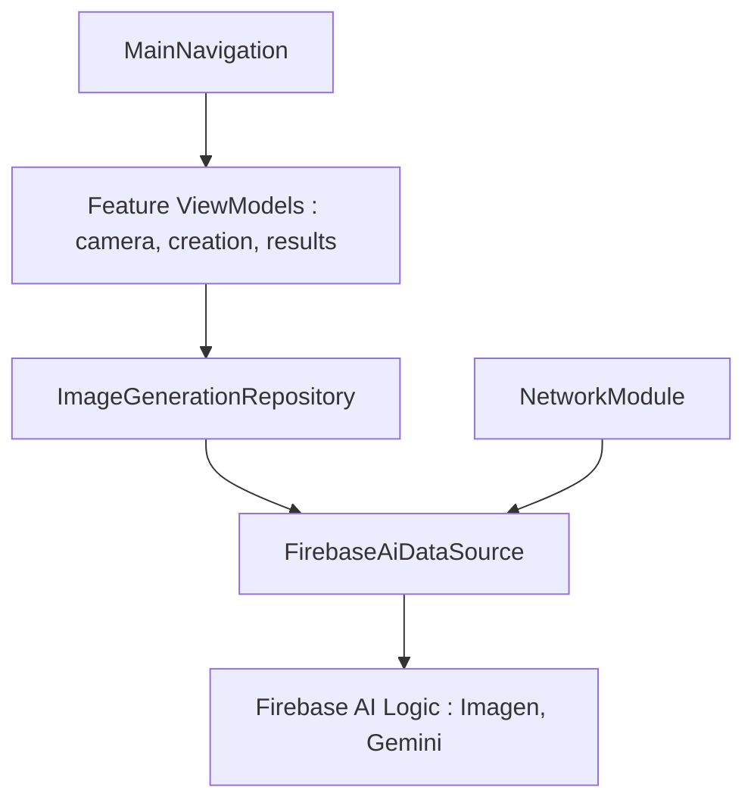

# android/androidify

> Appli Android d'exemple qui génère une mascotte avec Gemini, pour apprendre Compose, CameraX et Firebase AI.

## Le problème
Montrer comment bâtir une appli Android pilotée par IA avec les bibliothèques récentes, sans partir d'une page blanche.

## Ce que ça fait vraiment
L'utilisateur prend une photo, l'appli appelle Imagen et Gemini via le SDK Firebase AI Logic et affiche le robot généré. L'interface est en Jetpack Compose, la navigation en Navigation 3, la caméra en CameraX. Le code est modulaire (app, feature/*, data, core/*), en MVVM, avec Remote Config et App Check côté Firebase.

## Comment c'est branché


## Essayer
```bash
git clone https://github.com/android/androidify.git
# Placer google-services.json dans app/google-services.json
# Importer setup/remote_config_defaults.json dans Firebase Remote Config
```

## Coût et pièges
Il faut un projet Firebase avec Vertex AI activé et App Check pour éviter les abus. Appels de génération facturables. La fonction de fond n'est pas disponible dans plusieurs pays d'Europe, Moyen-Orient et Afrique.

## Ce que ce n'est pas
Pas un produit : un exemple encore en développement. Il génère des images avec un Imagen standard, pas le modèle affiné annoncé. Rien à voir avec du MLOps.

## Alternatives
Aucune alternative nommée dans le README.

## Pour toi
À surveiller : utile seulement si tu apprends Gemini sur mobile ; aucun intérêt direct pour un profil data ou MLOps.

