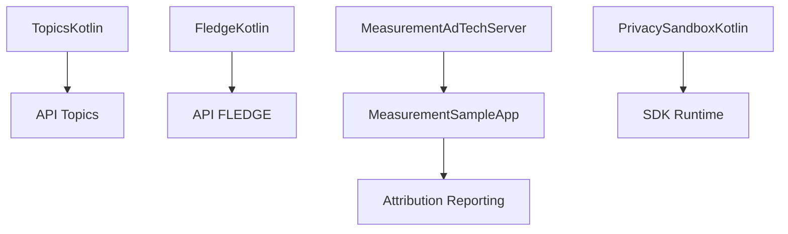

# android/privacy-sandbox-samples

> Sample Android Studio projects for the SDK Runtime and the Privacy Sandbox APIs, for Android developers.

## The problem
Testing the Privacy Sandbox APIs (advertising, measurement) requires working reference applications.

## What it actually does
A set of independent Android Studio projects: Topics (Kotlin, Java), FLEDGE, Attribution Reporting, an SDK running in a separate process, and OpenAPI specifications for mock ad servers. Three branches: `main` (Beta), `dev-preview-main`, `jetpack-main`. The README says Privacy Sandbox is in Alpha and advises against any use outside testing.

## How it is wired
Simplified diagram based on the sheet, no diagram provided.

## Trying it
No documented command: you open each project in Android Studio Canary.

## Cost and gotchas
Android Studio Canary is recommended; stable versions may cause problems. Choosing the right branch depends on the target version.

## What it is not
Not a library to integrate: these are demonstrations. The repository is archived and the APIs have changed since.

## Alternatives
None cited in the README.

## For you
Ignore: archived advertising Android samples, unrelated to your data / AI work.
