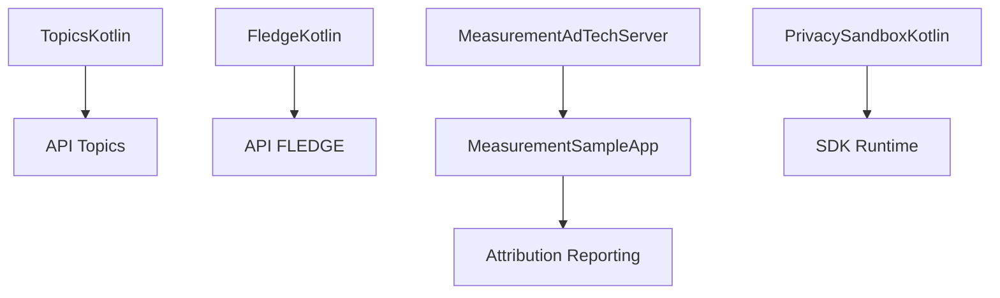

# android/privacy-sandbox-samples

> Projets Android Studio d'exemple pour le SDK Runtime et les API Privacy Sandbox, pour développeurs Android.

## Le problème
Tester les API Privacy Sandbox (publicité, mesure) demande des applications de référence fonctionnelles.

## Ce que ça fait vraiment
Un ensemble de projets Android Studio indépendants : Topics (Kotlin, Java), FLEDGE, Attribution Reporting, un SDK tournant dans un processus séparé, et des spécifications OpenAPI de serveurs publicitaires factices. Trois branches : `main` (Beta), `dev-preview-main`, `jetpack-main`. Le README dit que Privacy Sandbox est en Alpha et déconseille tout usage hors test.

## Comment c'est branché
Schéma simplifié d'après la fiche, sans diagramme fourni.

## Essayer
Aucune commande documentée : on ouvre chaque projet dans Android Studio Canary.

## Coût et pièges
Android Studio Canary recommandé, les versions stables peuvent poser problème. Le choix de la bonne branche dépend de la version cible.

## Ce que ce n'est pas
Pas une bibliothèque à intégrer : ce sont des démonstrations. Dépôt archivé, les API ont évolué depuis.

## Alternatives
Aucune citée dans le README.

## Pour toi
À ignorer : exemples Android publicitaires archivés, sans lien avec ton métier data / IA.

