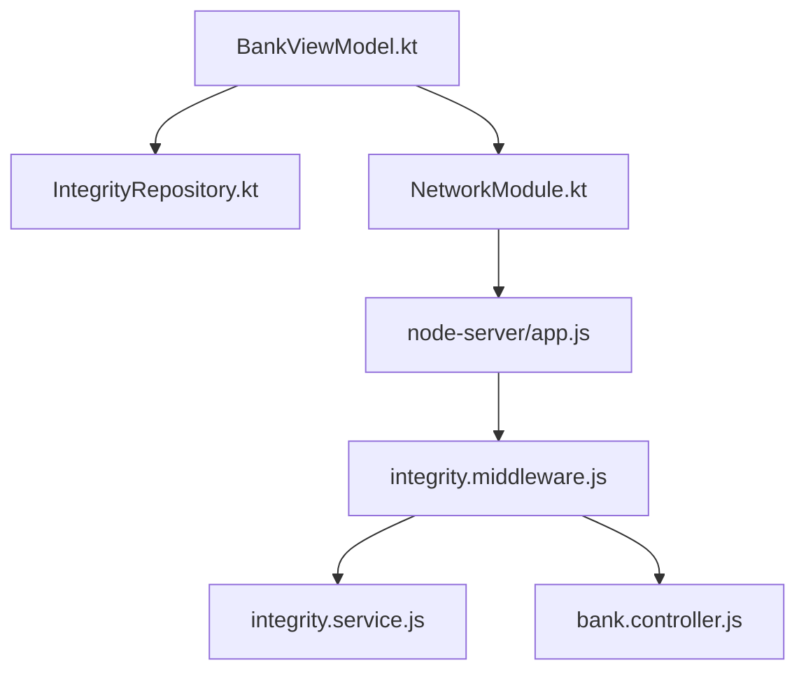

# android/security-samples

> Android security samples: end-to-end Play Integrity, biometrics, DirectBoot, for mobile developers.

## The problem
Correctly integrating the Play Integrity API, biometrics or protected storage requires reliable examples.

## What it actually does
The Play Integrity sample connects an Android client (`BankViewModel`, `IntegrityRepository`) to a Node server: the app obtains a token and sends it; `integrity.middleware.js` verifies it via `integrity.service.js` before `bank.controller.js` applies `bank.policy.js`. An APK signing example for developer verification exists. The biometrics and DirectBoot samples are independent and marked obsolete, with removal announced for March 2026.

## How it is wired

## Trying it
No documented command: follow the Play Console setup instructions in the sample.

## Cost and gotchas
Free. A Google Play Console account is required to test Play Integrity; Node for the server. The obsolete samples may disappear.

## What it is not
Not a reusable library: teaching examples.

## Alternatives
The other samples listed at developer.android.com/samples.

## For you
Ignore: Android mobile security is outside your data or AI scope.
