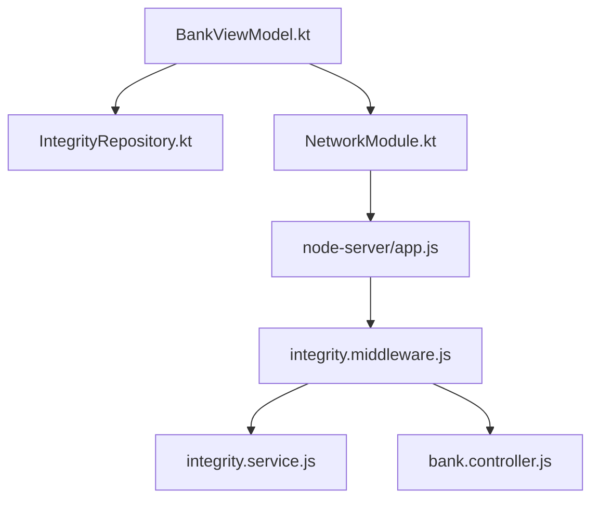

# android/security-samples

> Exemples Android de sécurité : Play Integrity de bout en bout, biométrie, DirectBoot, pour développeurs mobiles.

## Le problème
Intégrer correctement l'API Play Integrity, la biométrie ou le stockage protégé demande des exemples fiables.

## Ce que ça fait vraiment
L'exemple Play Integrity relie un client Android (`BankViewModel`, `IntegrityRepository`) à un serveur Node : l'app obtient un jeton et l'envoie ; `integrity.middleware.js` le vérifie via `integrity.service.js` avant que `bank.controller.js` applique `bank.policy.js`. Un exemple de signature d'APK pour la vérification des développeurs existe. Les exemples biométrie et DirectBoot sont indépendants et marqués obsolètes, suppression annoncée en mars 2026.

## Comment c'est branché

## Essayer
Aucune commande documentée : suivre les instructions de configuration de la Play Console dans l'exemple.

## Coût et pièges
Gratuit. Un compte Google Play Console est nécessaire pour tester Play Integrity ; Node pour le serveur. Les exemples obsolètes peuvent disparaître.

## Ce que ce n'est pas
Pas une bibliothèque réutilisable : des exemples pédagogiques.

## Alternatives
Les autres exemples listés sur developer.android.com/samples.

## Pour toi
À ignorer : sécurité mobile Android hors de ton périmètre data ou IA.

