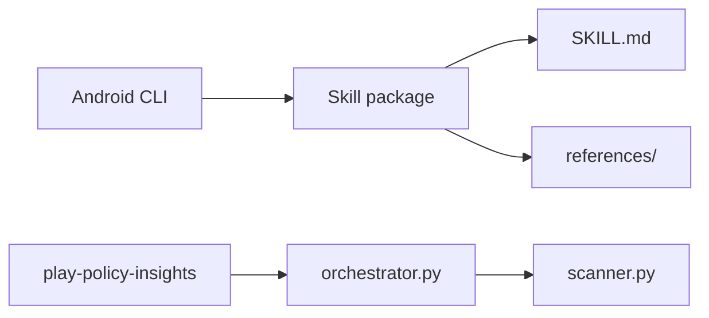

# android/skills

> AI agent skills for Android, installable with the Android CLI, on workflows where LLMs fail.

## The problem
LLMs apply some recent Android patterns poorly (migrations, R8, navigation 3...).

## What it actually does
A repository of `SKILL.md` folders with references drawn from developer.android.com, by domain: build, AppFunctions, Compose, navigation, Play, performance, security, testing, Wear, XR. One executable exception: `play/play-policy-insights` (Python scripts that analyze Play policies).

## How it is wired


## Trying it
```bash
android skills add r8-analyzer --project=.
android skills add --all
android skills update --all
```

## Cost and gotchas
Free. Without an existing agent folder, installation targets Gemini and Antigravity. The README reminds you that AI can be wrong.

## What it is not
Not an Android library: these are instructions for agents.

## Alternatives
No alternative named in the README.

## For you
Watch: an instructive model of well-structured skills, but mainly useful if you develop for Android.
