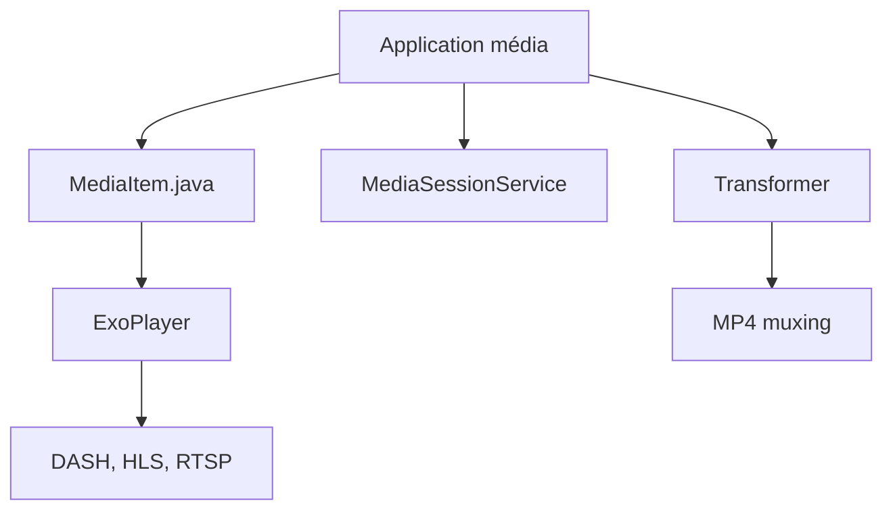

# androidx/media

> Android Media3 libraries: playback with ExoPlayer, video editing with Transformer, media sessions.

## The problem
Playing, streaming, downloading and transforming media on Android requires a lot of low-level code.

## What it actually does
ExoPlayer plays DASH, HLS and RTSP streams, with a playback UI and offline download. The session services and the controller handle remote commands, with Cast support. Transformer edits and re-encodes videos; an inspection module reads metadata. Advanced APIs are marked unstable and require an OptIn annotation.

## How it is wired


## Trying it
```bash
git clone https://github.com/androidx/media.git
```
Gradle dependency: `implementation("androidx.media3:media3-exoplayer:1.X.X")`, with the modules `media3-exoplayer-dash` and `media3-ui`.

## Cost and gotchas
Free. All modules must have the same version. Some modules depend on libraries you must build yourself, and 940 issues remain open.

## What it is not
Not a ready-to-use player: a toolbox for Android developers. Does not cover server-side media processing.

## Alternatives
Not documented in the README (a migration guide exists for former ExoPlayer and MediaSession users).

## For you
Ignore: useful only for Android multimedia app development, unrelated to data, AI or MLOps work.
