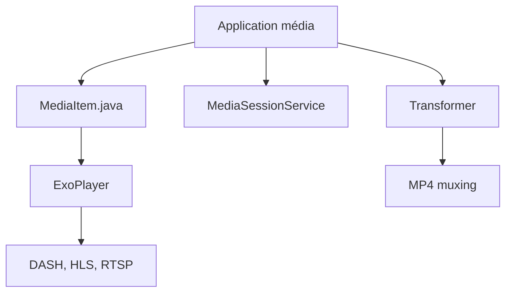

# androidx/media

> Bibliothèques Android Media3 : lecture avec ExoPlayer, montage vidéo avec Transformer, sessions média.

## Le problème
Lire, diffuser, télécharger et transformer des médias sur Android demande beaucoup de code bas niveau.

## Ce que ça fait vraiment
ExoPlayer lit des flux DASH, HLS et RTSP, avec interface de lecture et téléchargement hors ligne. Les services de session et le contrôleur gèrent les commandes à distance, avec prise en charge de Cast. Transformer édite et ré-encode des vidéos ; un module d'inspection lit les métadonnées. Les APIs avancées sont marquées instables et demandent une annotation OptIn.

## Comment c'est branché


## Essayer
```bash
git clone https://github.com/androidx/media.git
```
Dépendance Gradle : `implementation("androidx.media3:media3-exoplayer:1.X.X")`, avec les modules `media3-exoplayer-dash` et `media3-ui`.

## Coût et pièges
Gratuit. Tous les modules doivent avoir la même version. Certains modules dépendent de bibliothèques à compiler soi-même, et 940 issues restent ouvertes.

## Ce que ce n'est pas
Pas un lecteur prêt à l'emploi : une boîte à outils pour développeurs Android. Ne couvre pas le traitement de média côté serveur.

## Alternatives
Non documenté dans le README (un guide de migration existe pour les anciens utilisateurs d'ExoPlayer et MediaSession).

## Pour toi
À ignorer : utile uniquement pour du développement d'applications Android multimédia, sans lien avec un travail data, IA ou MLOps.

