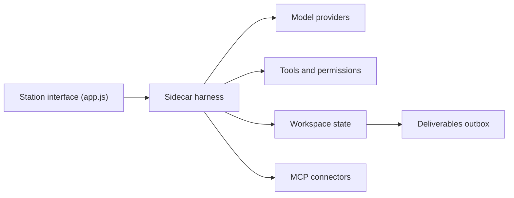

# androoAGI/starnet

> Desktop application that represents AI agents as a pixel-art station whose floor plan drives the work.

## The problem
Agents launched in a chat have no scope, no cost traceability and no clear deliverables.

## What it actually does
A local Node sidecar runs real model and tool calls, with bounded permissions, separate workspaces, memory, transcripts and spending ledgers on disk. The interface (JavaScript, Tauri shell) projects the real state: a room is a team, a corridor an authorized handoff. Telegram, Discord, Slack, Signal and Matrix channels, MCP connectors, schedules, "Night Shift" mode.

## How it is wired


## Trying it
```bash
git clone https://github.com/androoAGI/starnet.git
cd starnet
node sidecar/index.js
npm run desktop:dev
```

## Cost and gotchas
An OpenRouter key or OAuth connection (Anthropic, OpenAI, Google), or Ollama locally (smaller models). Windows is the most tested target; macOS less so; Linux is not publicly supported. Model requests leave the machine.

## What it is not
Not a data pipeline orchestration tool. The README speaks of an "early release"; the guarantees ("nothing simulated") are commitments by the author.

## Alternatives
No alternative cited; the README only offers to import an agent from OpenClaw or Hermes.

## For you
Ignore: general-purpose agent harness in an early version, run by one person, with no link to data or MLOps work.
