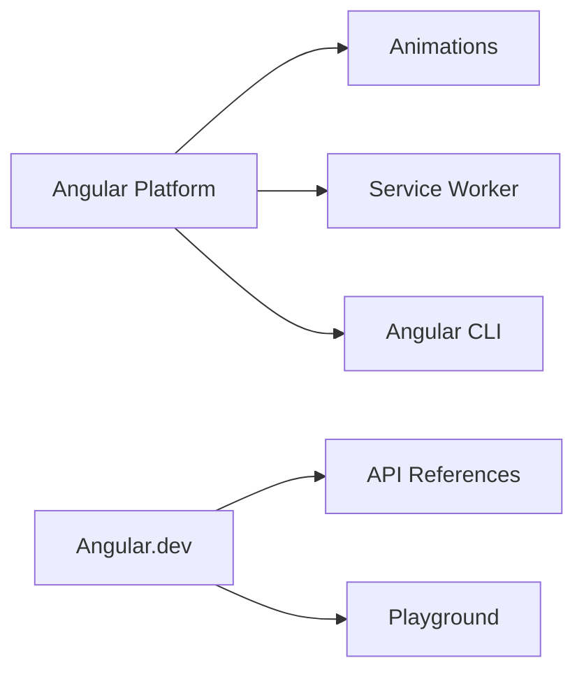

# angular/angular

> TypeScript platform for building web applications, with a CLI and development tools.

## The problem
Large web applications need a shared structure: components, forms, routing, server rendering.

## What it actually does
The repository contains the framework as well as the angular.dev site (guides, API references, interactive editor) and Angular DevTools. The README points to the documentation: components, forms, Angular elements, SSR, schematics, lazy loading, animations. The sampled code only covers animations and the service worker cache.

## How it is wired


## Trying it
```bash
npm install -g @angular/cli
ng new [PROJECT NAME]
cd [PROJECT NAME]
ng serve
```

## Cost and gotchas
Free. Node and npm required. The README names no company: governance is inferred from the owner, to be confirmed.

## What it is not
Not a tool for data or ML. Not a lightweight framework: it is a complete platform.

## Alternatives
No alternative named in the README.

## For you
Ignore, unless you are building an enterprise web interface in Angular: nothing here for a data or MLOps pipeline.
