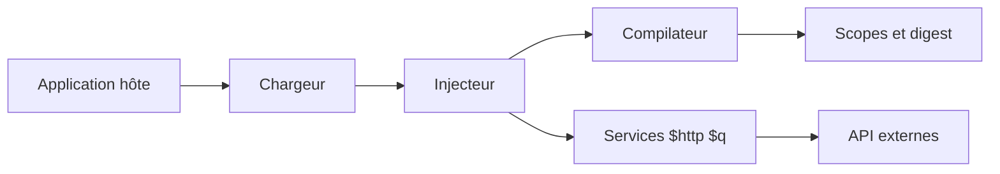

# angular/angular.js

> Old JavaScript framework with two-way data binding, whose support has ended.

## The problem
Building single-page web applications with HTML templates, dependency injection and automatic view/model synchronization.

## What it actually does
AngularJS extends HTML with directives, synchronizes the interface and JavaScript objects (scopes, digest loop), provides an injector, a template compiler, `$http`, `$q` and optional modules (ngRoute, ngResource, ngAnimate, ngSanitize…). Support officially ended in January 2022; the repository is archived, last push 2024-04-12.

## How it is wired

## Trying it
No documented command: the README points to the tutorial on docs.angularjs.org.

## Cost and gotchas
Free, but no more fixes; the README points to angular.io for the version that is maintained.

## What it is not
It is not Angular (the current framework): AngularJS is a separate, discontinued project.

## Alternatives
No alternative named in the README, apart from the pointer to angular.io.

## For you
Ignore: archived and out of support, of no interest for a data or AI profile.
