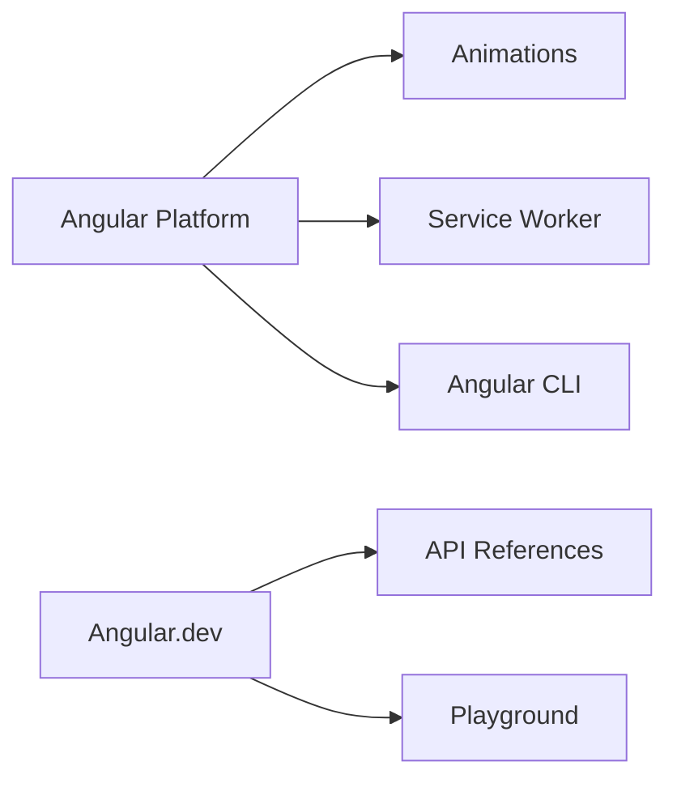

# angular/angular

> Plateforme TypeScript pour construire des applications web, avec CLI et outils de développement.

## Le problème
Les grosses applications web demandent une structure commune : composants, formulaires, routage, rendu serveur.

## Ce que ça fait vraiment
Le dépôt contient le framework et aussi le site angular.dev (guides, références d'API, éditeur interactif) et Angular DevTools. Le README renvoie vers la documentation : composants, formulaires, éléments Angular, SSR, schematics, chargement différé, animations. Le code échantillonné ne couvre que animations et cache du service worker.

## Comment c'est branché


## Essayer
```bash
npm install -g @angular/cli
ng new [PROJECT NAME]
cd [PROJECT NAME]
ng serve
```

## Coût et pièges
Gratuit. Node et npm requis. Le README ne cite pas d'entreprise : gouvernance déduite du propriétaire, à confirmer.

## Ce que ce n'est pas
Pas un outil pour la donnée ou le ML. Pas un framework léger : c'est une plateforme complète.

## Alternatives
Aucune alternative nommée dans le README.

## Pour toi
À ignorer, sauf si tu construis une interface web d'entreprise en Angular : rien ici pour un pipeline data ou MLOps.

