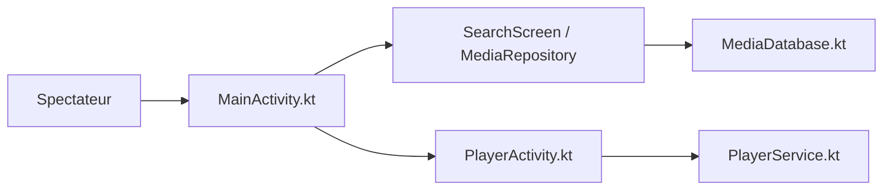

# anilbeesetti/nextplayer

> Native Android video player in Kotlin, ad-free, with an Android TV version.

## The problem
Free Android video players are often full of ads and excessive permissions.

## What it actually does
Plays local or network videos (SMB, FTP, SFTP, WebDAV), with choice of audio and subtitle tracks, brightness, volume and seek gestures, speed, zoom, picture-in-picture and background playback. A media picker browses tree, folders and files. Playback goes through a playback activity and a media session service; a database keeps history and playlists.

## How it is wired

## Trying it
No documented command. Download the APK from the GitHub releases; the SHA-256 fingerprint of the certificate is given in the README.

## Cost and gotchas
Free. A project "under development" with bugs expected (495 open issues).

## What it is not
Not a media server. Features announced but absent: external audio, online subtitles.

## Alternatives
No alternative named in the README (Findroid, LibreTube cited in the credits).

## For you
Ignore: a general-public Android player, outside the data/AI scope.
