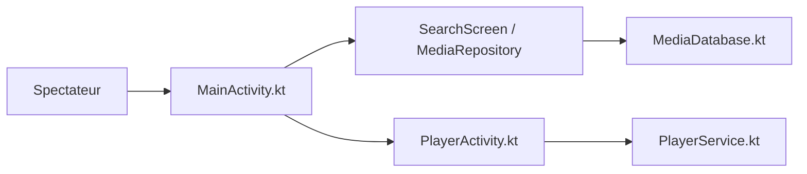

# anilbeesetti/nextplayer

> Lecteur vidéo Android natif en Kotlin, sans publicité, avec version Android TV.

## Le problème
Les lecteurs vidéo Android gratuits sont souvent pleins de publicités et de permissions excessives.

## Ce que ça fait vraiment
Lit vidéos locales ou réseau (SMB, FTP, SFTP, WebDAV), avec choix des pistes audio et sous-titres, gestes de luminosité, volume et avance, vitesse, zoom, picture-in-picture et lecture en arrière-plan. Un sélecteur de médias parcourt arbre, dossiers et fichiers. La lecture passe par une activité de lecture et un service de session média ; une base garde historique et playlists.

## Comment c'est branché

## Essayer
Aucune commande documentée. Télécharger l'APK depuis les releases GitHub ; l'empreinte SHA-256 du certificat est donnée dans le README.

## Coût et pièges
Gratuit. Projet « en développement » avec bugs attendus (495 issues ouvertes).

## Ce que ce n'est pas
Pas un serveur multimédia. Fonctions annoncées mais absentes : audio externe, sous-titres en ligne.

## Alternatives
Aucune alternative nommée dans le README (Findroid, LibreTube cités en crédits).

## Pour toi
À ignorer : lecteur Android grand public, hors périmètre data/IA.

