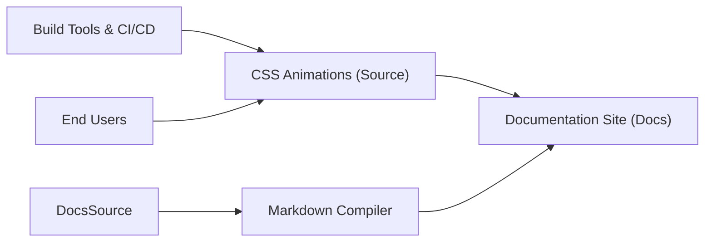

# animate-css/animate.css

> Ready-to-use CSS animation stylesheet, for web developers and designers.

## The problem
Hand-writing keyframes for every effect (bounce, fade, flip) is repetitive.

## What it actually does
Provides CSS animation classes (attention, bounces, fades, rotations...) to apply on elements. Respects the `prefers-reduced-motion` media query: a user who reduces animations in their system disables them with no extra work. The documentation is generated from `docsSource`.

## How it is wired


## Trying it
```shell
npm install animate.css --save
yarn add animate.css
```

## Cost and gotchas
Free, no dependency announced. The last push dates from July 2024: more than a year without activity.

## What it is not
Not a JavaScript animation engine nor a component library: only CSS classes. The README does not document usage, it points to the website.

## Alternatives
No alternative named in the README.

## For you
Ignore: it is front-end CSS unrelated to data / AI / MLOps pipelines, and activity is old.
