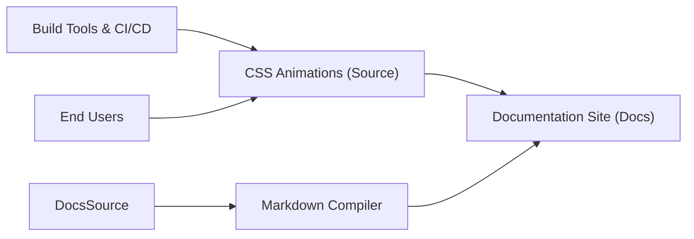

# animate-css/animate.css

> Feuille de style CSS d'animations prêtes à l'emploi, pour développeurs et designers web.

## Le problème
Écrire à la main des keyframes pour chaque effet (rebond, fondu, bascule) est répétitif.

## Ce que ça fait vraiment
Fournit des classes CSS d'animation (attention, rebonds, fondus, rotations…) à appliquer sur des éléments. Respecte la media query `prefers-reduced-motion` : l'utilisateur qui réduit les animations dans son système les désactive sans travail supplémentaire. La documentation est générée depuis `docsSource`.

## Comment c'est branché


## Essayer
```shell
npm install animate.css --save
yarn add animate.css
```

## Coût et pièges
Gratuit, aucune dépendance annoncée. Le dernier push date de juillet 2024 : plus d'un an sans activité.

## Ce que ce n'est pas
Pas un moteur d'animation JavaScript ni une bibliothèque de composants : uniquement des classes CSS. Le README ne documente pas l'usage, il renvoie au site.

## Alternatives
Aucune alternative nommée dans le README.

## Pour toi
À ignorer : c'est du CSS front-end sans lien avec les pipelines data / IA / MLOps, et l'activité est ancienne.

