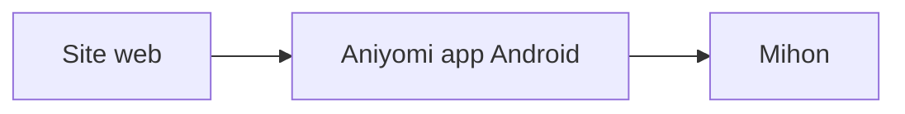

# aniyomiorg/aniyomi-website

> Website of Aniyomi, an Android reader/viewer built on Mihon, for watching anime and series.

## The problem
Giving the Aniyomi project a home page and repository links.

## What it actually does
The very short README only describes the project's tagline (reader and viewer for Android, based on Mihon) and thanks to contributors. The site's content is not documented. Title "Stolen Aniyomi Website" as is.

## How it is wired

## Trying it
No command documented.

## Cost and gotchas
Not documented. MPL-2.0 license.

## What it is not
Not the application itself, only its website.

## Alternatives
No alternative is cited in the README, which is very short. The project itself (reader and viewer for Android, based on Mihon) is the subject of the site, not a competitor.

## For you
Ignore: a showcase site for an Android entertainment app, of no value for data/AI/MLOps.
