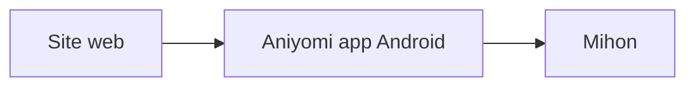

# aniyomiorg/aniyomi-website

> Site web d'Aniyomi, lecteur/visionneuse Android fondé sur Mihon, pour regarder anime et séries.

## Le problème
Donner une page d'accueil et des liens de dépôts au projet Aniyomi.

## Ce que ça fait vraiment
Le README, très court, ne décrit que le slogan du projet (lecteur et visionneuse pour Android, basé sur Mihon) et des remerciements aux contributeurs. Le contenu du site n'est pas documenté. Titre « Stolen Aniyomi Website » tel quel.

## Comment c'est branché

## Essayer
Aucune commande documentée.

## Coût et pièges
Non documenté. Licence MPL-2.0.

## Ce que ce n'est pas
Pas l'application elle-même, seulement son site.

## Alternatives
Mihon (cité comme base du projet).

## Pour toi
À ignorer : un site vitrine pour une appli de divertissement Android, sans valeur pour data/IA/MLOps.

