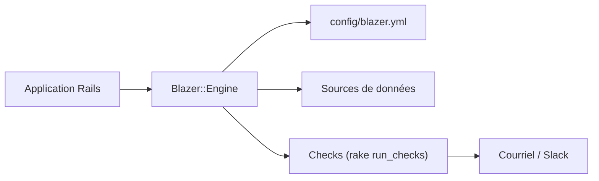

# ankane/blazer

> Rails engine to explore your data in SQL, build charts and dashboards, and share them.

## The problem
Teams want to query the database and share queries without setting up a full BI tool.

## What it actually does
It mounts inside a Rails application. It stores SQL queries with variables, generates charts based on the returned columns, assembles dashboards, schedules checks with email or Slack alerts, and audits queries. It handles cohorts, anomaly detection and forecasting (Prophet, Trend), and a long list of data sources.

## How it is wired

Simplified diagram based on the sheet, no diagram provided.

## Trying it
```bash
rails generate blazer:install
rails db:migrate
# routes.rb : mount Blazer::Engine, at: "blazer"
rake blazer:run_checks SCHEDULE="5 minutes"
```

## Cost and gotchas
Free. You need a Rails application (or the Docker image) and a read-only database user: the rolled-back transaction protection is a safety net, not a guarantee. Protect access to the dashboard.

## What it is not
It is not a general-purpose BI tool or a notebook: it is a SQL engine grafted onto Rails. Charts depend on column order.

## Alternatives
No alternative named in the README.

## For you
Keep an eye on it: handy for quickly exposing SQL and data quality checks to a team, provided you go through Rails or Docker.
