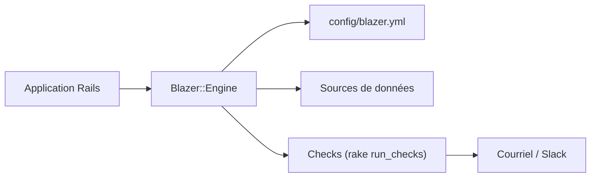

# ankane/blazer

> Moteur Rails pour explorer ses données en SQL, créer graphiques et tableaux de bord, et les partager.

## Le problème
Les équipes veulent interroger la base et partager des requêtes sans monter un outil BI complet.

## Ce que ça fait vraiment
Il se monte dans une application Rails. Il stocke des requêtes SQL à variables, génère des graphiques selon les colonnes retournées, assemble des tableaux de bord, planifie des vérifications avec alertes par courriel ou Slack, et trace les requêtes. Il gère cohortes, détection d'anomalies et prévisions (Prophet, Trend), et une longue liste de sources de données.

## Comment c'est branché

Schéma simplifié d'après la fiche, sans diagramme fourni.

## Essayer
```bash
rails generate blazer:install
rails db:migrate
# routes.rb : mount Blazer::Engine, at: "blazer"
rake blazer:run_checks SCHEDULE="5 minutes"
```

## Coût et pièges
Gratuit. Il faut une application Rails (ou l'image Docker) et un utilisateur de base en lecture seule : la protection par transaction annulée est un filet, pas une garantie. Protéger l'accès au tableau de bord.

## Ce que ce n'est pas
Ce n'est pas un outil BI généraliste ni un notebook : c'est un moteur SQL greffé sur Rails. Les graphiques dépendent de l'ordre des colonnes.

## Alternatives
Aucune alternative nommée dans le README.

## Pour toi
À surveiller : pratique pour exposer vite du SQL et des contrôles de qualité de données à une équipe, à condition de passer par Rails ou Docker.

