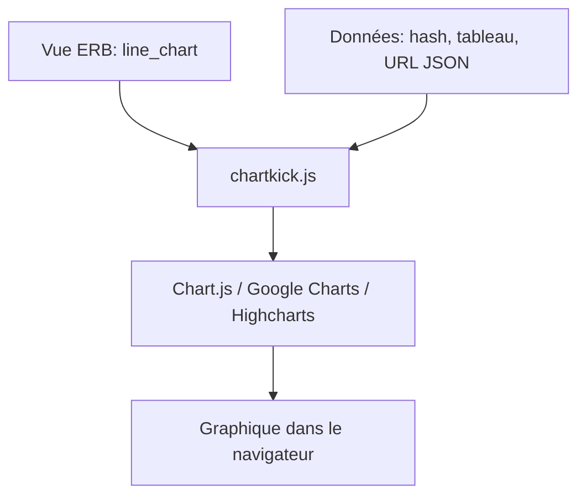

# ankane/chartkick

> Ruby gem that creates JavaScript charts in one line, for Rails applications.

## The problem
Integrating a JavaScript charting library into a Ruby application requires repetitive configuration.

## What it actually does
Provides helpers (`line_chart`, `pie_chart`, `column_chart`...) that generate the JavaScript. Accepts a hash, an array or a JSON URL. Uses Chart.js by default, or Google Charts or Highcharts. Options: colors, axes, legend, download, remote refresh. A JavaScript API lets you update or destroy a chart.

## How it is wired
Simplified diagram based on the sheet, no diagram provided.



## Trying it
```ruby
gem "chartkick"
```
```bash
bun add chartkick chart.js
```

## Cost and gotchas
Free. The charting engine is an extra component to install. Google Charts loads an external script.

## What it is not
Not a BI tool: the README points to Blazer for dashboards. Ruby only.

## Alternatives
- Blazer: for admin dashboards.
- Vega: for advanced visualizations.

## For you
Ignore: useful for a Rails application, not for a data / AI profile working in Python.
