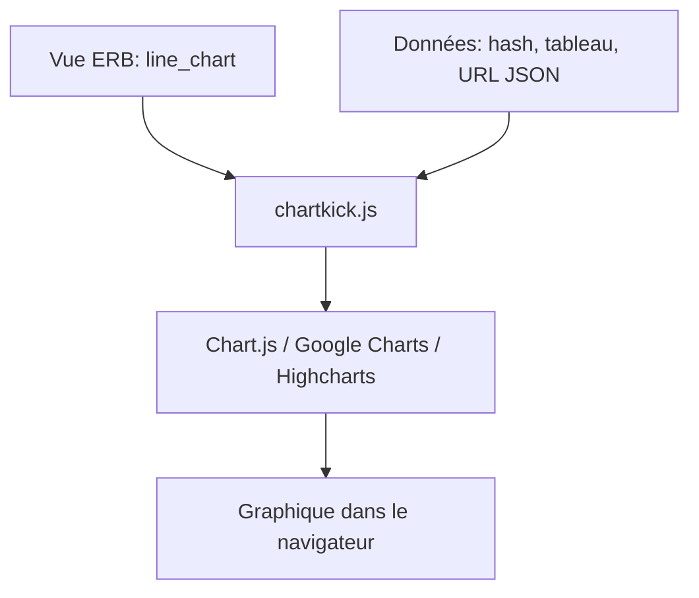

# ankane/chartkick

> Gem Ruby qui crée des graphiques JavaScript en une ligne, pour les applications Rails.

## Le problème
Intégrer une bibliothèque de graphiques JavaScript à une application Ruby demande de la configuration répétitive.

## Ce que ça fait vraiment
Fournit des helpers (`line_chart`, `pie_chart`, `column_chart`...) qui génèrent le JavaScript. Prend un hash, un tableau ou une URL JSON. Utilise Chart.js par défaut, ou Google Charts ou Highcharts. Options : couleurs, axes, légende, téléchargement, rafraîchissement distant. Une API JavaScript permet de mettre à jour ou détruire un graphique.

## Comment c'est branché
Schéma simplifié d'après la fiche, sans diagramme fourni.



## Essayer
```ruby
gem "chartkick"
```
```bash
bun add chartkick chart.js
```

## Coût et pièges
Gratuit. Le moteur de graphiques est un composant à installer en plus. Google Charts charge un script externe.

## Ce que ce n'est pas
Pas un outil de BI : le README renvoie à Blazer pour les tableaux de bord. Réservé à Ruby.

## Alternatives
- Blazer : pour tableaux de bord d'administration.
- Vega : pour visualisations avancées.

## Pour toi
À ignorer : utile pour une application Rails, pas pour un profil data / IA qui travaille en Python.

