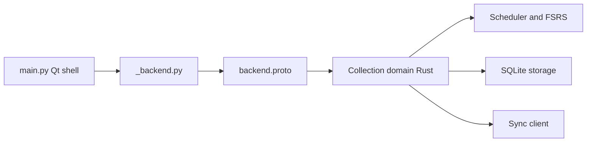

# ankitects/anki

> Source code of the desktop spaced-repetition flashcard software, for students and maintainers.

## The problem
The README does not say; the tool is used to memorise cards durably through spaced repetition.

## What it actually does
The README is three lines long (source of the desktop version, link to the betas). Based on the code: a Qt/Python client (`aqt`) in front of a Rust core (`rslib`) that handles collections, scheduling (including FSRS), card rendering, import, search and SQLite storage. Python and Rust talk to each other through protobuf. The embedded web interface is in Svelte/TypeScript. An AnkiWeb-compatible sync server is shipped.

## How it is wired

## Trying it
No command in the README: it points to the website for the betas.

## Cost and gotchas
Free. Building it yourself requires Rust, Python, Qt 6, Node and protobuf. Licence not identified by GitHub: read it in the repository.

## What it is not
Not a mobile application: AnkiDroid and AnkiMobile are separate. The README documents neither features nor installation.

## Alternatives
No alternative cited in the README.

## For you
Worth watching: reference FSRS scheduling implementation in Rust, to study if you are building a learning tool, otherwise of no direct interest.
