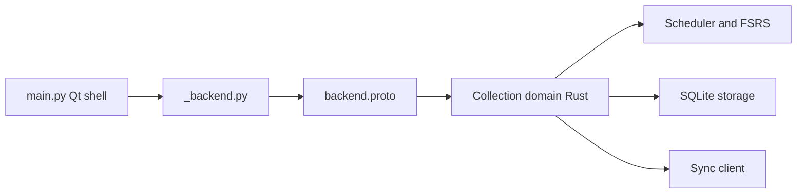

# ankitects/anki

> Code source du logiciel de bureau de cartes à répétition espacée, pour étudiants et mainteneurs.

## Le problème
Le README ne le dit pas ; l'outil sert à mémoriser durablement des cartes par répétition espacée.

## Ce que ça fait vraiment
Le README tient en trois lignes (source de la version bureau, lien vers les bêtas). D'après le code : client Qt/Python (`aqt`) devant un cœur Rust (`rslib`) qui gère collections, planification (dont FSRS), rendu des cartes, import, recherche et stockage SQLite. Python et Rust se parlent par protobuf. L'interface web embarquée est en Svelte/TypeScript. Un serveur de synchronisation compatible AnkiWeb est livré.

## Comment c'est branché

## Essayer
Aucune commande dans le README : il renvoie vers le site pour les bêtas.

## Coût et pièges
Gratuit. Compiler soi-même demande Rust, Python, Qt 6, Node et protobuf. Licence non identifiée par GitHub : à lire dans le dépôt.

## Ce que ce n'est pas
Pas une application mobile : AnkiDroid et AnkiMobile sont à part. Le README ne documente ni fonctions ni installation.

## Alternatives
Aucune alternative citée dans le README.

## Pour toi
À surveiller : référence de planification FSRS en Rust, à étudier si tu construis un outil d'apprentissage, sinon sans intérêt direct.

