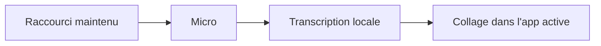

# anomalyco/hex

> Local voice dictation for Mac, Windows and Linux: hold a key, speak, the text is pasted.

## The problem
Dictate without sending your voice to a cloud service.

## What it actually does
- Hold a shortcut, speak, release: on-device transcription, then pasting into the active application.
- The first launch downloads a speech model; afterwards, according to the README, nothing leaves the machine.
- Experimental features in "Labs", at the bottom of the sidebar.
- Which speech engine or model: not documented in the provided README.

## How it is wired
No diagram provided; diagram drawn from the README alone.


## Trying it
```bash
brew install --cask anomalyco/tap/hex
yay -S hex-bin
nix profile install github:anomalyco/hex
curl -fsSL https://anoma.ly/hex/install-linux.sh | sh
```

## Cost and gotchas
Free; a model is downloaded on first launch. macOS: Apple silicon only.

## What it is not
Not a data / AI tool: a desktop application. Short README; accuracy, languages and model are not documented here.

## Alternatives
No alternative named in the README.

## For you
Worth watching: useful as a personal local dictation convenience, unrelated to your job, and the README is too thin to judge quality.
