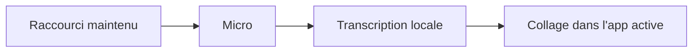

# anomalyco/hex

> Dictée vocale locale pour Mac, Windows et Linux : maintiens une touche, parle, le texte est collé.

## Le problème
Dicter sans envoyer sa voix à un service cloud.

## Ce que ça fait vraiment
- Raccourci maintenu, parole, relâchement : transcription sur l'appareil puis collage dans l'application active.
- Le premier lancement télécharge un modèle de parole ; ensuite, selon le README, rien ne quitte la machine.
- Fonctions expérimentales dans « Labs », en bas de la barre latérale.
- Quelle moteur ou quel modèle de parole : non documenté dans le README fourni.

## Comment c'est branché
Pas de diagramme fourni ; schéma tiré du README seul.


## Essayer
```bash
brew install --cask anomalyco/tap/hex
yay -S hex-bin
nix profile install github:anomalyco/hex
curl -fsSL https://anoma.ly/hex/install-linux.sh | sh
```

## Coût et pièges
Gratuit ; téléchargement d'un modèle au premier lancement. macOS : Apple silicon uniquement.

## Ce que ce n'est pas
Pas un outil pour data / IA : une application de bureau. README court, la précision, les langues et le modèle ne sont pas documentés ici.

## Alternatives
Aucune alternative nommée dans le README.

## Pour toi
À surveiller : utile comme confort personnel de dictée locale, sans lien avec ton métier, et README trop mince pour juger la qualité.

