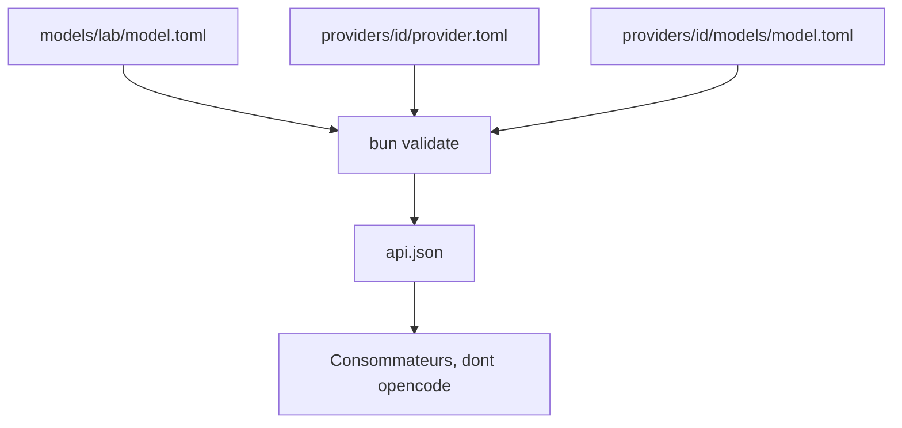

# anomalyco/models.dev

> Open database, with an API, of AI model specifications, prices and capabilities, for developers.

## The problem
No single source lists the available models, their context windows and their prices per host.

## What it actually does
TOML files per provider and per model, validated by `bun validate`, published as a JSON API (`api.json`, `models.json`, `catalog.json`). Lab model sheets carry the shared facts; host sheets carry prices and reasoning controls. Logos are served as SVG.

## How it is wired

Diagram not provided: simplified diagram based on the README.

## Trying it
```bash
curl https://models.dev/api.json
curl "https://models.dev/api.json?type=all"
curl https://models.dev/models.json
curl https://models.dev/catalog.json
```

## Cost and gotchas
Free. Community-contributed data: cross-check with the provider's docs for any critical costing.

## What it is not
Not a benchmark or a quality comparator. It is a metadata database.

## Alternatives
No alternative named in the README.

## For you
Adopt: a simple API to feed prices, contexts and capabilities into your routing or cost-tracking tools.
