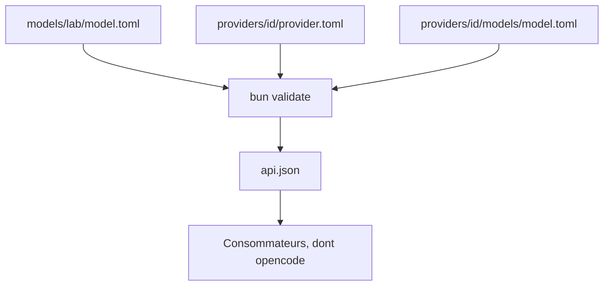

# anomalyco/models.dev

> Base ouverte, avec API, des spécifications, prix et capacités de modèles d'IA, pour développeurs.

## Le problème
Aucune source unique ne recense les modèles disponibles, leurs fenêtres de contexte et leurs tarifs par hébergeur.

## Ce que ça fait vraiment
Des fichiers TOML par fournisseur et par modèle, validés par `bun validate`, publiés sous forme d'API JSON (`api.json`, `models.json`, `catalog.json`). Les fiches de modèles de laboratoire portent les faits communs, les fiches d'hébergeur portent prix et contrôles de raisonnement. Les logos sont servis en SVG.

## Comment c'est branché

Schéma non fourni : diagramme simplifié d'après le README.

## Essayer
```bash
curl https://models.dev/api.json
curl "https://models.dev/api.json?type=all"
curl https://models.dev/models.json
curl https://models.dev/catalog.json
```

## Coût et pièges
Gratuit. Données contribuées par la communauté : à croiser avec la doc du fournisseur pour un chiffrage critique.

## Ce que ce n'est pas
Pas un benchmark ni un comparateur de qualité. C'est une base de métadonnées.

## Alternatives
Aucune alternative nommée dans le README.

## Pour toi
À adopter : une API simple pour alimenter prix, contextes et capacités dans tes outils de routage ou de suivi de coûts.

