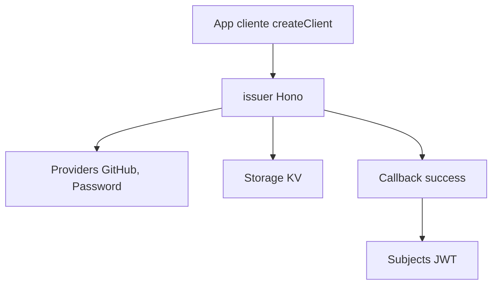

# anomalyco/openauth

> Self-hosted OAuth 2.0 authentication server, in TypeScript, for web apps, mobile apps and APIs.

## The problem
Centralized auth servers are SaaS (Auth0, Clerk); open source libraries are tied to a single application.

## What it actually does
The `issuer` function creates a Hono app that implements the OAuth server. You plug in providers (GitHub, password, PIN code), a key-value store (memory, DynamoDB, Cloudflare KV) and "subjects" validated by valibot. A `success` callback lets the app manage its users; OpenAuth does no user management. The access token is a JWT.

## How it is wired
Simplified diagram based on the fiche, no diagram provided.



## Trying it
```ts
import { issuer } from "@openauthjs/openauth"
import { MemoryStorage } from "@openauthjs/openauth/storage/memory"
import { createClient } from "@openauthjs/openauth/client"
```
The README gives no shell installation command.

## Cost and gotchas
Free, but you host it yourself (Node, Bun, Lambda, Cloudflare Workers). The README says "beta". Last push on 2025-07-18, with 147 open issues.

## What it is not
Not a user management solution nor a managed service. Not ready for you if you want guaranteed stability: the beta is announced.

## Alternatives
- Auth0: managed SaaS, cited in the README as the classic centralized approach.
- Clerk: same, SaaS.

## For you
Worth watching: interesting for securing a model service or an internal dashboard, but beta and no commit for over a year.
