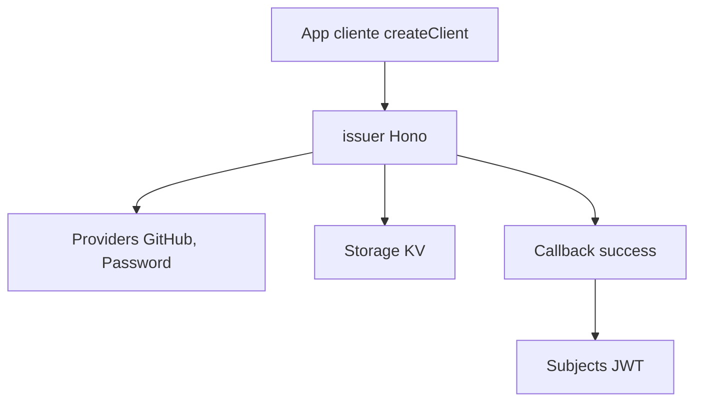

# anomalyco/openauth

> Serveur d'authentification OAuth 2.0 auto-hébergé, en TypeScript, pour applications web, mobiles et APIs.

## Le problème
Les serveurs d'auth centralisés sont des SaaS (Auth0, Clerk) ; les bibliothèques open source sont liées à une seule application.

## Ce que ça fait vraiment
La fonction `issuer` crée une appli Hono qui implémente le serveur OAuth. On branche des providers (GitHub, mot de passe, code PIN), un stockage clé-valeur (mémoire, DynamoDB, Cloudflare KV) et des « subjects » validés par valibot. Un callback `success` laisse l'appli gérer ses utilisateurs ; OpenAuth ne fait pas de gestion d'utilisateurs. Le jeton d'accès est un JWT.

## Comment c'est branché
Schéma simplifié d'après la fiche, sans diagramme fourni.



## Essayer
```ts
import { issuer } from "@openauthjs/openauth"
import { MemoryStorage } from "@openauthjs/openauth/storage/memory"
import { createClient } from "@openauthjs/openauth/client"
```
Le README ne donne pas de commande d'installation shell.

## Coût et pièges
Gratuit, mais à héberger soi-même (Node, Bun, Lambda, Cloudflare Workers). Le README indique « beta ». Dernier push le 2025-07-18, avec 147 issues ouvertes.

## Ce que ce n'est pas
Pas une solution de gestion d'utilisateurs ni un service géré. Pas prêt pour toi si tu veux de la stabilité garantie : la beta est annoncée.

## Alternatives
- Auth0 : SaaS géré, cité dans le README comme l'approche centralisée classique.
- Clerk : idem, SaaS.

## Pour toi
À surveiller : intéressant pour sécuriser un service de modèles ou un tableau de bord interne, mais beta et sans commit depuis plus d'un an.

