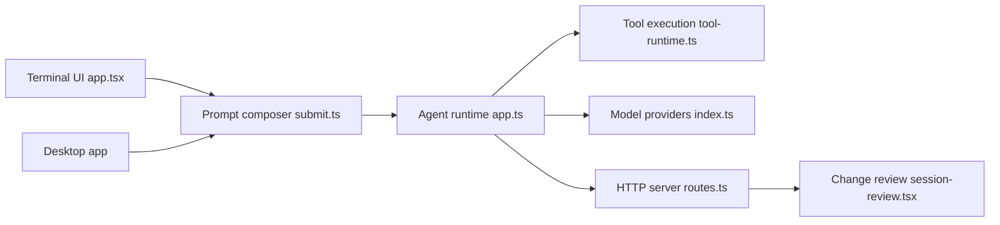

# anomalyco/opencode

> Open-source code agent for both terminal and desktop applications, with build and deployment features.

## The problem
Proprietary code agents are typically contained within a single vendor and interface. An open agent, which can be used with multiple models, is required.

## What it actually does
Start a code session in a terminal application or desktop app (beta). Two integrated agents, which can be switched between using `Tab`: `build` (full access) and `plan` (read-only, prevents edits, requires bash beforehand). A sub-agent, `general`, is used for multi-step searches. The code shows information about model providers, an HTTP server, GUI extensions, SSH connections, and session change review.

## How it is wired


## Trying it
```bash
curl -fsSL https://opencode.ai/v2/install | bash
npm i -g @opencode/cli@latest
brew install anomalyco/tap/opencode-v2
```

## Cost and gotchas
The models are your responsibility (API keys, not detailed in this README). The README indicates two brewing formulas and advises removing versions prior to 0.1.x before installation.

## What it is not
Not a single one-size-fits-all product: multiple channels (npm, brew, pacman, nix) with different update frequencies. Projects named "opencode-…" by third parties are not affiliated with the team. 3,670 open issues: a lot of activity.

## Alternatives
No alternative is specified in the README file.

## For you
Things to watch out for: a multi-model, open-source agent that can be useful for comparing models in MLOps, but with limited documentation on vendor configurations and a high volume of issues.
