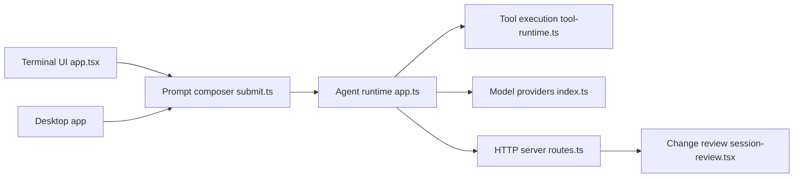

# anomalyco/opencode

> Agent de code open source en terminal et application de bureau, avec agents build et plan.

## Le problème
Les agents de code propriétaires enferment dans un fournisseur et une interface. Il faut un agent ouvert, utilisable avec plusieurs modèles.

## Ce que ça fait vraiment
Ouvre une session de code dans un TUI ou une appli de bureau (bêta). Deux agents intégrés, basculables avec `Tab` : `build` (accès complet) et `plan` (lecture seule, refuse les éditions, demande avant bash). Un sous-agent `general` sert aux recherches multi-étapes. Le code montre fournisseurs de modèles, serveur HTTP, extensions GUI, connexions SSH et revue des changements de session.

## Comment c'est branché


## Essayer
```bash
curl -fsSL https://opencode.ai/v2/install | bash
npm i -g @opencode/cli@latest
brew install anomalyco/tap/opencode-v2
```

## Coût et pièges
Les modèles sont à ta charge (clés d'API, non détaillées dans ce README). Le README signale deux formules brew et un conseil de retirer les versions antérieures à 0.1.x avant installation.

## Ce que ce n'est pas
Pas un produit à l'installation unique : plusieurs canaux (npm, brew, pacman, nix) avec des fraîcheurs différentes. Les projets nommés « opencode-… » par des tiers ne sont pas affiliés à l'équipe. 3 670 issues ouvertes : beaucoup de mouvement.

## Alternatives
Aucune alternative nommée dans le README.

## Pour toi
À surveiller : agent ouvert multi-modèles utile pour comparer des modèles en MLOps, mais README maigre sur les configurations de fournisseurs et fort volume d'issues.

