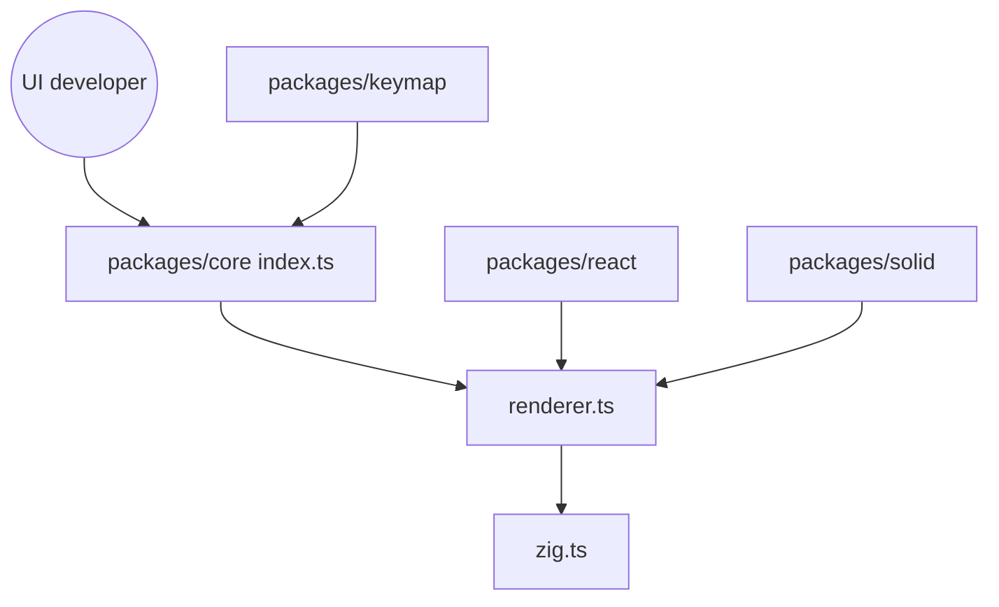

# anomalyco/opentui

> Zig and TypeScript library for building terminal interfaces, with React and Solid adapters.

## The problem
Building a rich terminal interface (fields, scrolling, mouse, images) by hand is tedious.

## What it actually does
A native Zig core with TypeScript bindings, flexbox rendering, components (selectors, fields, scrollable areas) and React and Solid adapters. Side packages: keyboard shortcut handling, QR codes, Three.js 3D rendering, SSH server. OpenCode uses it in production according to the README. An agent skill installable with `npx skills` documents the library.

## How it is wired


## Trying it
```bash
npx skills add https://opentui.com --skill opentui
bun install
bun run test
```

## Cost and gotchas
Free. Development requires Bun 1.4.1+ and Zig 0.17.0. The commands for installing the library as a dependency are not in this README.

## What it is not
Not an application: a tool for building them. The native folders, examples and site are private, unpublished spaces.

## Alternatives
No alternative named in the README.

## For you
Worth watching: useful if you build a terminal tool (for agents, for example), irrelevant for pure data work.
