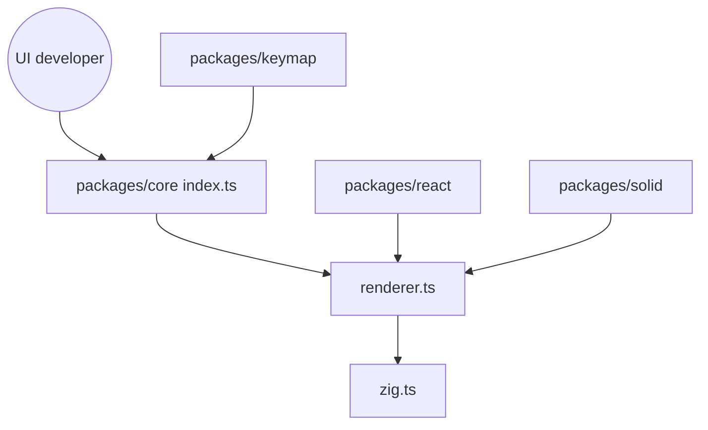

# anomalyco/opentui

> Bibliothèque Zig et TypeScript pour construire des interfaces terminal, avec adaptateurs React et Solid.

## Le problème
Construire une interface terminal riche (champs, défilement, souris, images) à la main est fastidieux.

## Ce que ça fait vraiment
Un cœur natif en Zig avec liaisons TypeScript, un rendu par flexbox, des composants (sélecteurs, champs, zones défilantes) et des adaptateurs React et Solid. Paquets annexes : gestion des raccourcis clavier, QR codes, rendu 3D Three.js, serveur SSH. OpenCode l'utilise en production selon le README. Un skill d'agent installable par `npx skills` documente la bibliothèque.

## Comment c'est branché


## Essayer
```bash
npx skills add https://opentui.com --skill opentui
bun install
bun run test
```

## Coût et pièges
Gratuit. Le développement exige Bun 1.4.1+ et Zig 0.17.0. Les commandes d'installation de la bibliothèque comme dépendance ne figurent pas dans ce README.

## Ce que ce n'est pas
Pas une application : un outil pour en construire. Les dossiers natifs, exemples et site sont des espaces privés non publiés.

## Alternatives
Aucune alternative nommée dans le README.

## Pour toi
À surveiller : utile si tu construis un outil en terminal (par exemple pour agents), sans objet pour un travail data pur.

