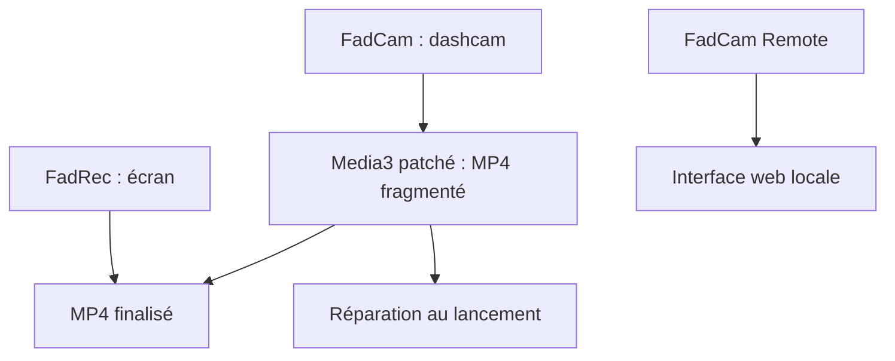

# anonfaded/FadCam

> Ad-free Android app for background recording, dashcam, screen recording and camera streaming.

## The problem
Android video recorders are either full of ads or killed by the system when the screen turns off.

## What it actually does
Records in the background with the screen off, with file splitting, watermark, geolocation. Hybrid MP4 format through a patched Media3: fragmented during recording, finalized on stop, repaired at next launch if the process is killed. Streams the camera over the local network with remote control. Screen recording module with annotations. A paid Pro version exists.

## How it is wired
Simplified diagram based on the sheet, no diagram provided.



## Trying it
```bash
# README : aucune commande.
# Télécharger l'APK depuis la page des releases, ou installer via F-Droid / IzzyOnDroid.
```

## Cost and gotchas
Free at the base level, paid lifetime "Pro" access. Camera, microphone, location permissions. GPL-3.0 license (copyleft). The README warns about ethical use: unauthorized surveillance is prohibited.

## What it is not
Not a hidden-surveillance tool to be encouraged; the author discourages it. Not designed for platforms other than Android.

## Alternatives
No alternative named in the README.

## For you
Ignore: consumer app unrelated to data/AI/MLOps work.
