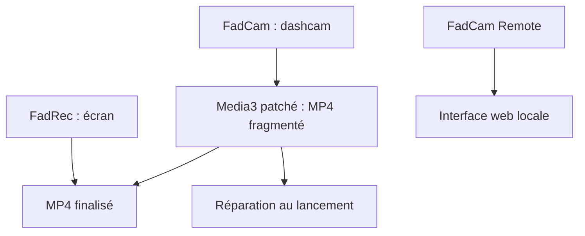

# anonfaded/FadCam

> Application Android sans pub pour enregistrer en arrière-plan, faire dashcam, enregistrer l'écran et diffuser la caméra.

## Le problème
Les enregistreurs vidéo Android sont soit pleins de publicités, soit coupés par le système quand l'écran s'éteint.

## Ce que ça fait vraiment
Enregistre en arrière-plan écran éteint, avec découpage des fichiers, filigrane, géolocalisation. Format MP4 hybride via un Media3 patché : fragmenté pendant l'enregistrement, finalisé à l'arrêt, réparé au prochain lancement si le processus est tué. Diffusion de la caméra sur le réseau local avec contrôle à distance. Module d'enregistrement d'écran avec annotations. Une version Pro payante existe.

## Comment c'est branché
Schéma simplifié d'après la fiche, sans diagramme fourni.



## Essayer
```bash
# README : aucune commande.
# Télécharger l'APK depuis la page des releases, ou installer via F-Droid / IzzyOnDroid.
```

## Coût et pièges
Gratuit en base, accès « Pro » payant à vie. Droits caméra, micro, localisation. Licence GPL-3.0 (copyleft). Le README alerte sur l'usage éthique : la surveillance non autorisée est interdite.

## Ce que ce n'est pas
Pas un outil de surveillance cachée à encourager ; l'auteur le déconseille. Pas pensé pour d'autres plateformes que Android.

## Alternatives
Aucune alternative nommée dans le README.

## Pour toi
À ignorer : application grand public sans lien avec le travail data/IA/MLOps.

