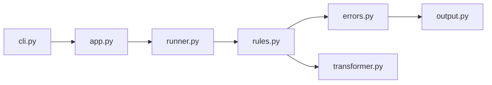

# ansible/ansible-lint

> Linter for Ansible playbooks and roles that flags dubious practices, usable in CI via a GitHub Action.

## The problem
Playbooks drift toward fragile practices (syntax, idempotence, schemas) without automatic checks.

## What it actually does
One command launches a run: file discovery, YAML loading, rule application, then reporting via formatters. Separate branches for syntax checking, schema validation, exclusions (skip) and automatic fixes. Supports only the last two major versions of Ansible.

## How it is wired


## Trying it
```yaml
# .github/workflows/ansible-lint.yml
name: ansible-lint
on:
  pull_request:
    branches: ["main", "stable", "release/v*"]
jobs:
  build:
    name: Ansible Lint
    runs-on: ubuntu-24.04
    steps:
      - uses: actions/checkout@v6
      - name: Run ansible-lint
        uses: ansible/ansible-lint@main
```

## Cost and gotchas
Free. The README recommends pinning a release tag rather than `@main` in production.

## What it is not
Neither a runner nor a tester of playbooks: it analyzes statically. GPLv3 license because of dependencies, the project's own code historically remaining MIT.

## Alternatives
yamllint is used as a dependency, not as a replacement.

## For you
Relevant if you automate MLOps infrastructure with Ansible; otherwise keep it in mind: watch.
