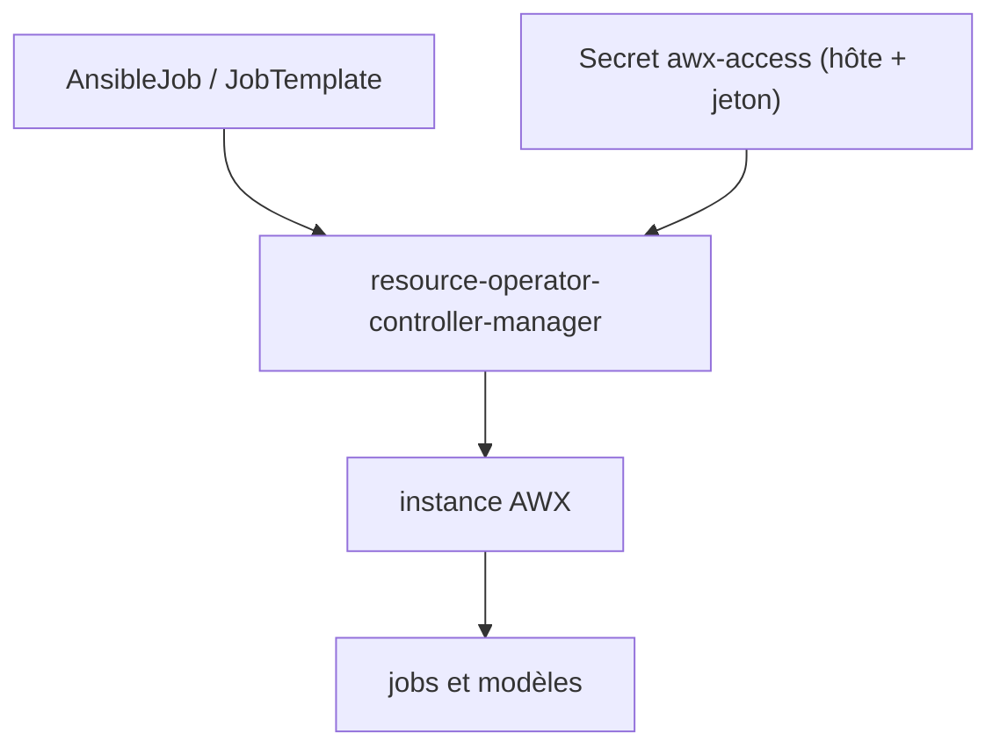

# ansible/awx-resource-operator

> Kubernetes operator that launches jobs and creates AWX job templates from Kubernetes resources.

## The problem
Triggering AWX automation from a Kubernetes cluster normally means going through the AWX interface or API.

## What it actually does
Two custom resources: `AnsibleJob` launches a job (or a workflow) on the AWX instance given in a Kubernetes secret, and `JobTemplate` creates a job template. You can set the inventory, extra variables, labels and time to live. The operator is built with Operator SDK and Ansible.

## How it is wired
Simplified diagram based on the sheet, no diagram provided.


## Trying it
```bash
git clone git@github.com:ansible/awx-resource-operator.git
NAMESPACE=awx IMG=quay.io/ansible/awx-resource-operator:latest make deploy
kubectl create -f awx-connection-secret.yml
```

## Cost and gotchas
Kubernetes or OpenShift cluster, AWX deployed with the awx-operator and an OAuth2 token. "Prompt on launch" must be enabled for the inventory and variables. License not declared.

## What it is not
Not AWX nor its installer: it assumes one is already in place.

## Alternatives
The awx-operator is cited as the building block to deploy first, not as an alternative.

## For you
Watch: useful if you orchestrate Ansible automation from Kubernetes in an MLOps chain; otherwise off topic.
