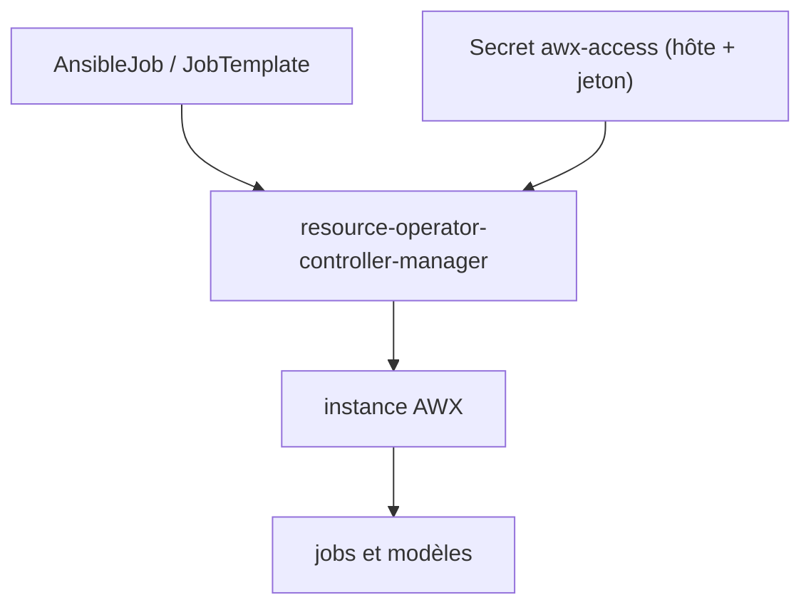

# ansible/awx-resource-operator

> Opérateur Kubernetes qui lance des jobs et crée des modèles de jobs AWX par ressources Kubernetes.

## Le problème
Déclencher l'automatisation AWX depuis un cluster Kubernetes demande normalement de passer par l'interface ou l'API d'AWX.

## Ce que ça fait vraiment
Deux ressources personnalisées : `AnsibleJob` lance un job (ou un workflow) sur l'instance AWX indiquée dans un secret Kubernetes, et `JobTemplate` crée un modèle de job. On peut fixer l'inventaire, les variables supplémentaires, les étiquettes et la durée de vie. L'opérateur est construit avec Operator SDK et Ansible.

## Comment c'est branché
Schéma simplifié d'après la fiche, sans diagramme fourni.


## Essayer
```bash
git clone git@github.com:ansible/awx-resource-operator.git
NAMESPACE=awx IMG=quay.io/ansible/awx-resource-operator:latest make deploy
kubectl create -f awx-connection-secret.yml
```

## Coût et pièges
Cluster Kubernetes ou OpenShift, AWX déployé avec l'awx-operator et jeton OAuth2. « Prompt on launch » doit être activé pour l'inventaire et les variables. Licence non déclarée.

## Ce que ce n'est pas
Pas AWX ni son installateur : il en suppose un déjà en place.

## Alternatives
L'awx-operator est cité comme la brique à déployer d'abord, pas comme alternative.

## Pour toi
À surveiller : utile si tu orchestres de l'automatisation Ansible depuis Kubernetes dans une chaîne MLOps ; sinon hors sujet.

